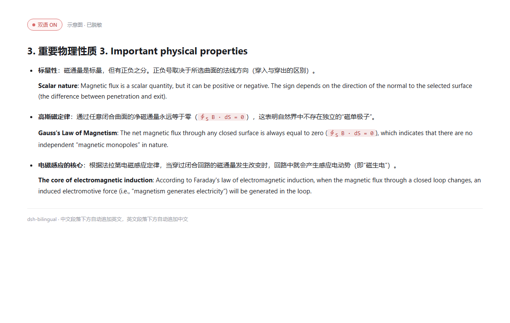

# dsh-bilingual · 中英逐段翻译 / 双语对照（DSH 桌面端）

给 **DeepSeek Harness 桌面端（DSH Desktop）** 的聊天界面加一个「双语」开关：**开启后，助手回复的每一段原文下面自动追加另一种语言**（逐段翻译 / 中英对照）。

> **适用平台：** DSH Desktop（Windows / macOS / Linux 的桌面应用）。插件安装到 `profiles/desktop`；同一套 Web GUI 架构下也可用于 `dsh web`，当前主要在桌面端验证。



- 原文是中文 → 下面加英文；
- 原文是英文 → 下面加中文；
- 标题的译文拼在同一行（`3. 重要物理性质 3. Important physical properties`）；
- 列表项的译文仍在该条项目符号内，前面留一个空行，和原文形成两段；
- 代码块、块级公式、HTML 块原样保留，不翻译；表格会生成一张完整的译文表附在原文表下方；
- 只改显示：会话记录、发给模型的上下文、复制按钮都仍是原文。

```
### 3. 重要物理性质 3. Important physical properties

- **标量性**：磁通量是标量，但有正负之分。正负号取决于所选曲面的法线方向。

  **Scalar nature**: Magnetic flux is a scalar quantity, but it can be positive or negative.
  The sign depends on the direction of the normal to the selected surface.

- **高斯磁定律**：通过任意闭合曲面的净磁通量永远等于零。

  **Gauss's Law of Magnetism**: The net magnetic flux through any closed surface is always zero.
```

## 安装

### 从 npm 安装（推荐）

已发布为 npm 包 `dsh-bilingual@0.1.5`：

```powershell
dsh plugin --profile desktop add dsh-bilingual
```

也可以在 DSH 的插件市场里搜索 `dsh-bilingual` 或 `逐段翻译`。

### 本地 link（开发）

本插件也可以按「本地 link」方式装进桌面 profile：

```powershell
# 1. 退出 DSH（或装完后再重启）
# 2. 在插件目录执行：
& "$env:LOCALAPPDATA\Programs\DeepSeek Harness\resources\runtime\bin\node.exe" install.mjs --profile desktop

# 3. 重新打开 DSH
```

`install.mjs` 会做三件事（都会先备份 `package.json`）：

1. 在 `profiles/<profile>/package.json` 的 `dependencies` 里加
   `"dsh-bilingual": "link:<本目录>"`；
2. 在 `dsh.profile.bundles` 里加 `"dsh-bilingual"`；
3. 在 `profiles/<profile>/node_modules/dsh-bilingual` 建一个指向本目录的 junction。

> 也可以用 DSH 的插件管理器以「本地链接」方式安装；本质是同样三件事。

## 使用

1. 打开 **设置 → 双语**。
   - 插件会**自动复用 DSH 已保存的 `DEEPSEEK_API_KEY`**（`~/.dsh/.credentials.yaml` 里的凭据），通常不用再填；
   - 如果 DSH 里没有，粘贴一个 `sk-...`，点「保存」，再点「测试连接」；
   - 优先级：插件里填的 Key > 环境变量 `DEEPSEEK_API_KEY` > DSH 凭据；
   - 插件 Key 存在 `~/.dsh/dsh-bilingual.json`（`DSH_HOME` 下），不会写进会话，也不会回传到浏览器；
   - 模型默认 `deepseek-chat`，Base URL 默认 `https://api.deepseek.com`，可改成任意 OpenAI 兼容端点。
2. 回到对话，点会话头部的 **「双语」** 按钮开启。
   - 默认关闭；开关状态存在 `sessionStorage`，只对当前标签页生效；
   - 开启后，**已经落定的助手消息**会按可见区域逐条翻译；滚动到新消息时继续翻译；
   - 翻译只发生在显示层，刷新页面后同一段会命中本机缓存，不重复请求。
3. 关闭开关即恢复原文（缓存保留，下次开启直接复用）。

## 它是怎么做的

- **浏览器半**（`lib/client.js`）以 `priority: -10` 影子注册
  `conversation.chat.node` 的 `assistant-step` 渲染器；正文块从数据层拿原始 Markdown，
  经 `lib/markdown.cjs` 的行级切分后，把译文插回同一份 Markdown，再交给官方
  `MarkdownText` 渲染。标题/列表/引用因此保留原结构，列表译文仍在同一个 `<li>` 里。
- **宿主半**（`lib/index.js`）注册同源路由 `/api/dsh-bilingual/*`，代理 DeepSeek
  `chat/completions`：Key 只在服务端，浏览器不直连；批量请求、超时、错误归一化都在这里。
- **纯函数**（`lib/markdown.cjs`）负责切分、语言判断、译文清洗与拼装，有独立单测。

## 开发与自检

```powershell
# 构建：把 markdown.cjs 内联进 client.template.js → client.js
& "$env:LOCALAPPDATA\Programs\DeepSeek Harness\resources\runtime\bin\node.exe" build.mjs

# 测试（Markdown 切分/拼装、宿主路由、客户端 bundle 注册）
& "$env:LOCALAPPDATA\Programs\DeepSeek Harness\resources\runtime\bin\node.exe" --test tests/*.test.mjs
```

修改 `lib/client.js` 或 `lib/index.js` 后需要重启 DSH；只改客户端 bundle 时，重启后刷新页面即可。

## 已知边界

- **只翻助手回复正文**：用户消息、思考链、工具调用、工具输出不翻；代码块、块内公式不单独翻。表格整表翻译，表格单元格内的公式/代码按原样保留。
- **只处理中文/英文**：其他语言（日/韩/俄等）按“非中文即英文”的粗略判断处理，可能不翻或翻错方向。
- **目标语言是“另一种”**：不做“固定翻成中文”；中文段配英文、英文段配中文，正是本插件的用途。
- **依赖 DSH 的 assistant-step 数据形状**：DSH 大版本升级若改 `node.data.blocks` / `MarkdownText`，需要跟着适配；渲染抛错时会退回纯文本，不会白屏。
- **API 费用**：每段未命中缓存的文本都会发一次 DeepSeek 请求；长回复首次开启会批量请求，请留意用量。

## 卸载

1. 编辑 `profiles/desktop/package.json`：从 `dependencies` 删掉 `dsh-bilingual`，从
   `dsh.profile.bundles` 删掉 `dsh-bilingual`；
2. 删除 `profiles/desktop/node_modules/dsh-bilingual`（junction，不删源码）；
3. 重启 DSH。

可选：删除 `~/.dsh/dsh-bilingual.json`（会一并删掉保存的 Key）。

## License

MIT
